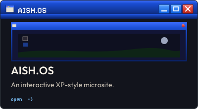
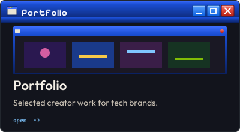
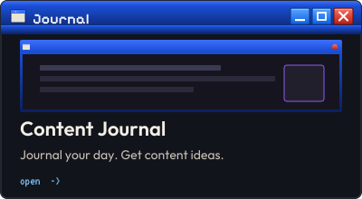

  

  

  
  
  
  

Designer and creative technologist. I make motion, illustration, and VFX for tech brands, and I vibe-code interactive microsites and AI-powered creative tools.

Independent creator, and a creator partner at WalletConnect. Previously design at KoinX, motion at The Sandbox, and design in the Hyperliquid ecosystem. UGC creator with 3M+ views on reels.

## Projects

  &nbsp;
  &nbsp;
  

## Tools

  

